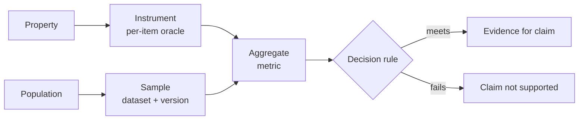
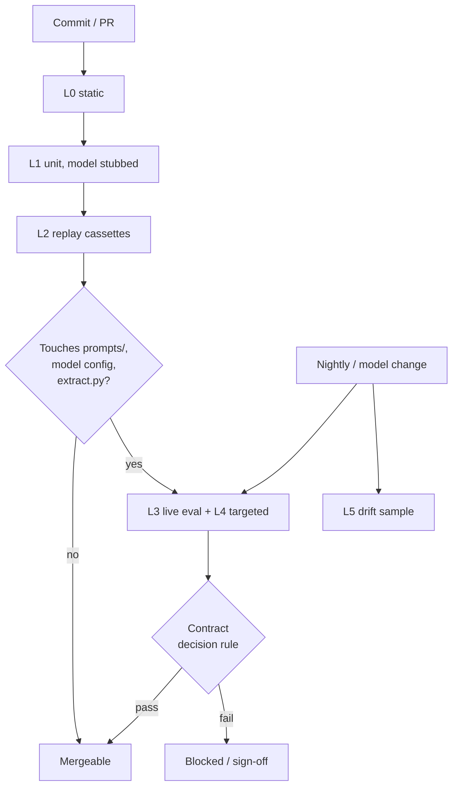

# Evaluation I: Claims, Datasets, Thresholds, and CI

These notes cover the first evaluation session. The running example is the triage
feature from W1 (see [`W1/triage-spec-examples`](../W1/triage-spec-examples/README.md)):
an LLM enriches a GitHub issue with structured fields (`issue_type`, `component`,
`severity`, `has_reproduction_steps`, `confidence`), the output is **validated** into a
`TriageRecord`, and a deterministic function routes it to a queue.

Key points: 
* An engineering claim must be supported by evidence, evaluation is a way to produce that evidence. 
* For a component that is not deterministic, the evidence is statistical.*

---

## 1. How claims are validated

### 1.1 Every project makes claims

Engineers make claims all the time:

| Claim | Kind | What would back it |
|---|---|---|
| "Routing is correct." | Correctness of a deterministic function | Tests over the specified cases; types; properties |
| "Triage works." | Quality of a stochastic component | A metric on a named dataset, with a threshold |
| "The new prompt is better." | Comparison | A paired comparison on the *same* items, with uncertainty |
| "The model upgrade didn't break anything." | Non-regression | A regression suite plus a non-inferiority rule |
| "Injected instructions in issue bodies have no effect." | Robustness / security | A targeted adversarial set; an architectural argument (the only channel is five validated fields) |
| "The agent fixed the bug." | Claim about *tool* output | Tests the agent did not write; review; reproduction |
| "Our instruction file improves agent success." | Claim about a *workflow* | Repeated runs of a task suite with and without it |


### 1.2 Components of validated claims

Any claim you want to defend has five parts. If one is missing, the claim cannot be checked:

1. **Property**: what is claimed (correct routing, accurate type, no regression).
2. **Population**: *over what* inputs (all inputs, the inputs in a spec, issues from three named repositories filed in 2025).
3. **Instrument**: how the property is observed on one input (an assertion, a comparison to a gold label, a. rubric score, a judge).
4. **Sample and aggregation**: which inputs were observed and how the observations are combined (all specified cases, or 400 sampled issues and a macro-F1).
5. **Decision rule**: when the evidence counts as *sufficient* (all pass, or the lower 95% confidence bound ≥ 0.75).



A classical unit test is the degenerate case of this structure:
* The population is the enumerated examples
* The instrument is an exact oracle (`assertEqual`)
* The aggregation is "all of them" 
* The decision rule is "100%". 
The test is binary because each of the other parts is.

For AI components, this simple rule does not apply:
* The population is large and only partly known. 
* The oracle is often a human judgment. 
* A single observation is one sample from a distribution of outputs. 
* No single output being right or wrong settles the whole claim.
The structure stays the same, but every part has to be stated explicitly.

### 1.3 Verification and validation

Boehm's distinction:

- **Verification**: *are we building the product right?* Does the artifact satisfy its specification?
- **Validation**: *are we building the right product?* Does the specification (and therefore the artifact) satisfy the need?

For AI components the two get mixed up easily. "macro-F1 = 0.81 on `dev.json`" is a verification result against a measurable target. Whether 0.81 is good enough for the maintainers who read the queues is a validation question. The threshold encodes it, and stakeholders have to sign off on the threshold (§3).

### 1.4 Why evaluation matters more with AI

- **Code is cheap, so claims are cheap.** An agent writes a feature and a report saying it works in minutes. The bottleneck moves from producing to *checking* (W1).
- **The artifacts change even when code doesn't.** Providers update the models behind aliases, your data drifts, and retrieval corpora grow. A claim that held last month can stop holding without any commit on your side.
- **Tuning is a form of fitting.** Every prompt edit you make after looking at dev-set failures fits the system to that set. Without a held-out set the evidence shows the tuning, not real quality.
- **Who checks the work is important.** When an agent writes both the code and its tests, a green run says only that the two are consistent with each other.

---

## 2. Task Specification requires Evaluation Design

### 2.1 The Test of a Specification

> If you cannot say how you would evaluate a task, you have not specified it.

Trying to write the evaluation is a reliable method to find gaps in a task description. 

Consider the example of "classify the issue type" in our running example and try to build its evaluation. 
You will have to answer the following questions:

- **Output specification.** What exactly is `meta`? Is a request for a new configuration option
  an `enhancement` or a `question`? The *Annotation guidelines* are the specification of
  the task. If two careful humans disagree on 30% of issues, we cannot expect the model to succeed
  at 95%: Inter-Annotator Agreement (IAA) defines an upper bound for performance on the task.
- **Input specification.** From which repositories do we sample issues, in which languages, and for which time window? 
  Are empty bodies, non-English issues, and issues that are mostly a stack trace considered valid?
- **Cost of errors and aggregation.** Are all errors equal? In ADR-0005 we identified that this is not the case: 
  missing a critical issue costs far more than a false alarm. 
  In this case, accuracy is the wrong metric, or at least not the only one.
  We need to define a better aggregation method to combine the judgment on each case into a single grade.
- **Failure behavior.** When validation fails twice and a `TriageFailure` is emitted.
  In such cases, does the evaluation count as wrong, as abstention, or exclude it? 
  (Excluding it rewards the system for failing on hard inputs.)

This is why in Milestone 2, we will require the evaluation suite and its thresholds to be *written before the implementation is finished*. 
If we write it first, the evaluation becomes part of the specification. 
If we write it after the implementation, there is a risk the evaluation suite may be contaminated.


### 2.2 Acceptance Criteria vs. Evaluation

The two concepts are often confused because both answer the same question: "how do we know it's done?". 
However, these concepts work at different levels:

| | Acceptance criterion (W2) | Evaluation |
|---|---|---|
| Unit | One scenario | A distribution of inputs |
| Form | Given / When / Then | Metric on a dataset + threshold + decision rule |
| Oracle | Exact, deterministic | Gold label, rubric, judge; may be noisy |
| Result | Pass / fail | An estimate with uncertainty |
| Failure means | A defect in this case | The rate is too high on this population |

The triage spec contains both acceptance criteria and evaluation requirements.
It is useful to distinguish them:

- *Deterministic contracts*, correspond to acceptance criteria and unit tests. For example:
  - Schema validation rejects `confidence = 1.3`. 
  - Unit tests verify that `repo` and `issue_number` come from the input.
  - Routing is a pure function. 
  - `pyright --strict` reports zero errors. 
  Each of these is either true or false, and one counterexample is a bug.
- *Quality targets*, which are evaluated: "`issue_type` macro-F1 ≥ 0.75 on the held-out split". 
*"These targets are evaluated, not unit-tested."*

A common mistake is writing a per-instance acceptance criterion for the stochastic part:

> *Given an issue whose body describes a crash with a stack trace, when it is
> enriched, then `issue_type` is `bug`.*

As a unit test this will either pass every time (the example is easy, so it adds little) 
or fail from time to time (the example is hard, so it is a flaky test). 
Neither outcome tells you whether the component is good enough. 
The scenario is still worth keeping, as **one item of an evaluation dataset** (§2.3), possibly tagged as a must-pass case (§4.4).

**Design principle.** 
- Keep the stochastic part as small as you can and make everything around it deterministic and unit-testable. 

For example, ADR-0001 (separate extraction from routing) does this: routing correctness can be tested, 
and only extraction quality needs statistics.

### 2.3 Datasets and Distributions

An evaluation number describes the dataset it was computed on. 
In order to generalized to production, the dataset must become a **specified distribution**:

- **Source**: from which repositories, platform, export date.
- **Sampling procedure**: all issues, random sample, or stratified by repository or label. What was excluded and why (bots, duplicates, non-English).
- **Time window**: when the issues were filed. Important to identify drift and contamination.
- **Label provenance**: who labeled, under which guidelines, how many labelers, and what was their agreement. 
  Labels copied from GitHub labels are *maintainers' habits*, not ground truth.
- **Version**: a content hash or tag. If the dataset changes between two runs, keeping track of metrics is not reliable.

A short **datasheet** <https://huggingface.co/papers/1803.09010> in `data/README.md` holding these five items is the minimum.
If you work with an existing dataset, you can usually find the corresponding datasheet.
Otherwise, create one using the following [format](datasheet.md). 

#### Dataset Splits 

| Split | Purpose | Who looks at it |
|---|---|---|
| `dev` (validation) | Tune prompts, choose models, set thresholds | Developers, as often as needed |
| `test` (held-out) | Estimate quality on unseen data | Nobody, until the decision; then once |
| Regression set | Items that failed in previous tests | Grows over time, run in CI |
| Targeted / adversarial sets | Specific capabilities and attacks | Reported separately, not averaged in overall results |

Every decision you make after looking at a set changes the system. 
The more you iterate on `dev`, the less the `dev` score tells you about new data and the less you will generalize. 
You can keep a part of dev "unseen" and use it to estimate generalization.

If you look at `test` and then change the system, `test` has become a second `dev`.

#### Representative vs. Targeted Datasets

These answer different questions and should not be averaged into one score:

- A **representative** sample estimates *production quality*: "on issues like the ones
  we will see, 81% are typed correctly". The mix of the population must match production
  according to the distribution on each significant features of the input.
  This constraint is called **stratification**.  
  For example, in our example, if our system must cover 3 distinct repositories, each one 
  producing the same number of issues, then the dataset must contain 1/3 of the data from each repository.
  If in addition we know that the distribution of bugs vs. change vs. documentation issues is 80%, 15%, 5%,
  then our dataset must have the same distribution. Similarly, we can stratify by issue description length etc.
- **Targeted** sets probe *specific behaviors* and are deliberately unrepresentative.
  Examples: issues with prompt-injection text, empty bodies, very long stack traces,
  titles in other languages, near-duplicate pairs. CheckList (Ribeiro et al., 2020)
  sorts these into three test types: *minimum functionality* (simple cases that must
  work), *invariance* (renaming a variable in the stack trace must not change the
  type), and *directional* (adding "this is a crash in production" must not *lower*
  severity). Invariance and directional tests are metamorphic tests. They need
  no gold label, only a relation between two outputs, so they are cheap to scale.

#### Slices

An aggregate can hide a failing subgroup. Report the metric **per slice**: per
repository, per class, per input length band. Macro-F1 gives rare classes
equal weight, while accuracy is dominated by the majority class.

> *Worked example (hypothetical class mix).* Suppose 60% of issues are `bug`, 20%
> `enhancement`, 10% `question`, 7% `documentation`, 3% `meta`. A "model" that always
> answers `bug` has **accuracy 0.60**. Its F1 on `bug` is 2·0.6·1/(0.6+1) = 0.75, and its
> F1 on every other class is 0, so its **macro-F1 is 0.15**. Accuracy makes this
> constant classifier look half-competent, and macro-F1 does not. Always report the
> trivial baseline next to your number (in this case, the trivial baseline would be "majority label").

#### Missing Labels, Leakage, and Drift

- **Missing labels are expensive for evaluation.** In the github issues dataset only
  `gold_type` exists, and it is null for roughly half the records. `gold_severity` is
  null everywhere. So the spec's requirement *"`severity` within-one-level agreement
  ≥ 0.85"* is **unverifiable as stated**: no data exists that could check it. It
  becomes verifiable only once someone labels severity. Also ask *which* half of
  `gold_type` is null. If labeled issues are the ones maintainers bothered to tag, the
  labeled subset is not a random sample (selection bias). It could be that only easy issues 
  have been tagged, or that maintainers used an automatic system to tag some issues.
- **Leakage and contamination.** Public GitHub issues are probably in the model's
  pretraining data, so the model may "remember" an issue's eventual labels and
  resolution. A temporal split (test issues filed after the model's training cutoff)
  is a standard defense against leakage. 
  Leakage can also come from your development process: 
  few-shot examples copied from `test`, or a retrieval index built over the test issues.
- **Drift.** The production distribution moves over time: new repositories, a new release
  with new components, new kinds of spam. Then the test-set number goes out of date.
  Keep sampling production data, label a small batch periodically, and compare
  (W12 improvement loop).

### 2.4 Rubrics

Some outputs have no single gold answer: a summary, a clarification comment asking
the reporter for reproduction steps, a code-review remark, an explanation. 
For such cases, a good evaluation instrument is a **rubric**: a list of criteria, each with a scale and *anchored*
descriptions of what each level looks like. Rubrics allow multi-dimensional evaluation.

Principles for effective rubrics:

1. **Decompose.** One holistic "quality 1–10" score is unreliable and impossible to
   act on. Separate criteria tell you *what* to fix.
2. **Prefer binary or 3-level criteria** with observable anchors. "Is the comment
   polite?" is vague. "Does the comment avoid blaming the reporter (no 'you should
   have…')?" can be checked and fixed.
3. **Separate gates from grades.** Some criteria are *must-haves* (no hallucinated
   facts, no leaked internal data). A violation fails the item whatever the other
   scores are. Do not let a high average hide a gate violation.
4. **Make criteria independent.** If two criteria always move together they measure
   the same dimension and give it double weight.
5. **Write the rubric from real outputs, then revise it.** evaluators only discover what 
   important grading items by grading actual outputs.
   Grade 20–30 outputs by hand before freezing your rubrics.
6. **Validate the rubric.** Have two people apply it to the same items and measure
   their agreement. Low agreement means the rubric is ambiguous. Fix it before handing it to an LLM judge.

*Example: rubric for an auto-generated clarification comment* 
(posted when a bug report has no reproduction steps):

| # | Criterion | Type | Levels |
|---|---|---|---|
| G1 | Contains no claims about the codebase | Gate | pass / fail |
| G2 | Does not repeat instructions found in the issue body | Gate | pass / fail |
| C1 | Asks for the *specific* missing information (version, minimal example, expected vs. actual) | Grade | 0 = generic "please add details"; 1 = names some items; 2 = names the items relevant to *this* issue |
| C2 | Is answerable in one reply (no open-ended questions) | Grade | 0 / 1 |
| C3 | Length ≤ 120 words | Grade (automatable) | 0 / 1 |
| C4 | Tone: neutral, no blame | Grade | 0 / 1 |

C3 needs no human or judge - it is an easy to check rubric.
Other rubrics require judgment.
We use LLM-as-a-Judge as a method to obtain such judgment automatically, but we must **calibrate** an LLM judge against human labels.

---

## 3. Acceptance Thresholds as Contracts

### 3.1 From Target to Contract

The triage spec's quality requirement is a starting point:

> *On the held-out split, the system SHALL achieve `issue_type` macro-F1 ≥ 0.75 …*

Read it as a contract a skeptical reviewer in order to identify gaps that must be completed:

- Which held-out split, and which version of it? How many items?
- Is the 0.75 a **point estimate** or a **lower confidence bound**? 
- How do records with null `gold_type` count? How do `TriageFailure`s count?
- Which model ID, prompt version, and sampling parameters? "The system" changes when
  the model behind an alias changes.
- May one repository score 0.40 as long as the average is 0.75?
- What happens if a later commit drops the score to 0.74: block the merge, roll back,
  or only alert?
- What is the cost and latency budget? A configuration that reaches 0.76 with a
  10-sample self-consistency vote may cost too much to deploy (that method requires you to re-run the LLM prompts 10 times on each issue and then vote on the best possible answer out of the 10 candidates).

A threshold is a **contract** in the same sense as an API: other parts of the system and other people rely on it. 
For example, routing relies on `confidence` [ADR-0005](../W1/triage-spec-examples/docs/adr/0005-escalate-on-low-confidence.md).
Similarly, maintainers would size their queues around the escalation rate. 


### 3.2 Structure of a Threshold Contract

*P_language* (Simmons, W2 reading) provides useful terminology to specify threshold contracts:

| Part | Planguage | Triage example |
|---|---|---|
| What is measured | **Scale** | Macro-F1 over the 5 `issue_type` classes; `TriageFailure` counts as a wrong prediction; null-gold records excluded and reported as a count |
| How it is measured | **Meter** | `triage eval --split test --dataset-version <hash>`, n ≥ 400 labeled items, model responses logged |
| Minimum acceptable | **Must** | Lower bound of the 95% bootstrap CI ≥ 0.70 (Confidence Interval) |
| Target | **Plan** | Point estimate ≥ 0.75 |
| Aspiration | **Wish** | ≥ 0.85 (approximate human agreement ceiling) |
| Conditions | **Qualifier** | `LLM_MODEL` pinned to a dated snapshot; temperature 0; prompt version from git SHA |
| Slice floor | *(extension)* | No repository's F1 below 0.60 |
| Non-regression | *(extension)* | Versus the current `main` baseline on the same items: difference ≥ −0.02 |
| Budget | *(extension)* | Mean cost ≤ $0.002 per issue; p95 latency ≤ 3 s |


### 3.3 Where Thresholds Come From

A threshold should not be picked out randomly or based on a guess. 
Derive it from at least one of these methods, and record which one:

- **Trivial baseline.** Constant-class, keyword rules, or the GitHub label if present.
  If you cannot beat the 0.15 macro-F1 of "always `bug`" by a wide margin, the feature
  has no reason to exist.
- **Current process.** How accurate is human triage today? Look at relabel rates in issue history.
- **Human agreement ceiling.** If two maintainers agree on `issue_type` 85% of the time, a 0.95 target is not meaningful.
- **Downstream cost.** ADR-0005's argument: a missed critical issue is expensive, so
  the contract should include a **recall on `critical`**, even at the cost of
  more escalations. When cost is asymmetric, metrics must also be asymmetric.
- **Capacity.** The escalation threshold is set so the escalation rate fits maintainer capacity. 

### 3.4 Thresholds as Code

For critical thresholds, store the contract in the repository as a reviewed file (e.g. `eval/contract.yaml`) 
and treat changes to it like changes to a public API.
You can design a domain-specific language (DSL) to encode the main decisions associated to your evaluation,
as in this example:

```yaml
# eval/contract.yaml  — changes require review by the eval owner (CODEOWNERS)
issue_type:
  metric: macro_f1
  dataset: data/snapshot/test.json@sha256:3f9c…
  min_labeled_items: 400
  failure_policy: count_as_wrong        # TriageFailure = wrong prediction
  must:   { stat: ci95_lower, value: 0.70 }
  plan:   { stat: point,      value: 0.75 }
  slices: { by: repo, floor: 0.60 }
  non_regression: { baseline: main, paired: true, max_drop: 0.02 }
conditions:
  model: <dated snapshot id, never an alias>
  temperature: 0
budget:
  cost_per_item_usd: 0.002
  latency_p95_s: 3.0
```

---

## 4. Regression Suites in Continuous Integration

### 4.1 What "Regression" Means for an AI Component

A regression is a change that makes something that used to work stop working. 
With an AI component, the change can come from:

- **your code** (refactoring the validator, changing retry logic),
- **your prompt or program** (a new instruction, new few-shot examples, a DSPy recompile),
- **your data** (a retrieval corpus update),
- **the provider**: a model alias now points to a new snapshot, a deprecation, or a
  silent serving-side change.

A CI design that only runs when your code changes misses the last category entirely.

### 4.2 Layered Suites

We cannot always re-run all the tests because it takes time and money. 
Instead, you must separate the layers of tests according to what they check and what they cost.
Your decisions will eventually be implemented in your Continuous Integration (CI) pipeline.
Here is a recommended baseline for such a CI policy:

| Layer | Checks | Determinism | When it runs | Decision Gate |
|---|---|---|---|---|
| **L0 Static** | Types (`pyright --strict`), lint, schema files | Deterministic | Every commit | Binary |
| **L1 Unit** | Validator, routing, retry logic, failure records, with the model *stubbed* | Deterministic | Every commit | Binary |
| **L2 Replay** | The full pipeline on **recorded** model responses ("cassettes"), checking plumbing end to end | Deterministic | Every PR | Binary |
| **L3 Live Eval** | The real model on the eval dataset; metrics vs. the contract | Stochastic | PRs that touch `prompts/`, model config, `extract.py`; nightly; before release | Statistical |
| **L4 Targeted** | Injection set, invariance/directional pairs, must-pass regression cases | Stochastic | Same as L3 | Per-set rules |
| **L5 Drift Watch** | Small fresh sample of production inputs, labeled periodically | Stochastic | Weekly / on model change | Alert, human review |

In order to enable L2, you must make sure you can rerun AI API calls from cached responses, so that if you rerun the same call, you obtain an identical output.
This functionality is supported by DSPy, but you must ensure you store the cache explicitly and reuse it when needed to support repeatable CI runs.
We call this producing "replay cassettes", which are the cached input/output pairs produced for a given test run.
L2 keeps CI fast, cheap, and deterministic for the large majority of changes, which never touch model behavior. 

L3 is where model behavior is measured, and it runs only when it can actually change - L3 actually costs new API calls (time and money).



This type of policy would be implemented in your DevOps platform.
For this course, we will use GitHub Actions to implement CI pipelines. 
For example:

```yaml
on:
  pull_request:
    paths: ["src/triage/prompts/**", "src/triage/extract.py", "config/model.toml", "eval/**"]
  schedule:
    - cron: "0 3 * * *"      # nightly: catches provider-side changes
```

### 4.3 Growing the Regression Set

Confirmed production failures must be collected as regression cases: the input, the expected
output (or a rubric judgment), and a link to the incident log entry.
Over time the regression set becomes the most valuable dataset you own, because it is made of the failures your
system actually had.

Notes about the regression set:
- Keep the regression set **out of** the representative population. 
  It is biased toward hard cases by construction. Report it as a separate metric.
- Do not delete a case because it is "flaky" (that is, it repeatedly turns success/fail over time). 
  Find out why first. A flaky case is often a boundary case, which is where systems are fragile.

### 4.4 Non-Determinism in CI

#### Sources of Non-Determinism

- **Sampling.** Temperature > 0 makes outputs random by design.
- **Temperature 0 is not deterministic either.** See [H. He et al. 2025]: Floating-point addition is not
  associative. The server batches your request with others, batch composition changes
  the order of reductions in GPU kernels, and a small numeric difference can flip an
  argmax early in decoding, after which the rest of the output diverges. 
  Mixture-of-experts routing and speculative decoding add more sources. 
  Most hosted APIs make no determinism guarantee, a `seed` parameter, where one exists, is usually documented as only best-effort.
- **Provider changes.** Silent system updates on the provider side.
- **Everything else.** Retrieval ties broken arbitrarily, timeouts and rate-limit retries. 
  These are the classic sources of flaky tests, which predate LLMs: Luo et al. (2014) classify these sources of non-determinism.
  Google reported that about 16% of its tests showed some flakiness (Micco, 2016).

#### What to Do About Non-Determinism

1. **Pin and record.** Use dated model snapshots, not aliases. Record the model ID,
   prompt hash, and parameters in every output and every eval report (the spec
   requires the model ID). 
   An eval result without provenance cannot be compared with anything.
2. **Replay Cassettes.** L0–L2 do not call a live model.
   This strategy removes non-determinism from the tests that check your code. 
   Cache keys in the replay cassettes must include `(model_id, prompt_hash, input_hash, params)` 
   so that a prompt change in your code misses the cache instead of quietly reusing stale responses.
3. **Never "retry until green" in CI tests.** If a stochastic test passes with probability *p* and
   CI retries up to *r* times, the gate passes with probability 1 − (1 − *p*)<sup>*r*</sup>.
   A case that fails 30% of the time would pass a 3-retry gate **97.3%** of the time. 
   This retry policy would hide the defect instead of detecting it. 
4. **Separate infrastructure failures from quality failures.** 
   An infrastructure failure means the CI test did not pass because the resources used to run the test 
   were exhausted or failed. For example, getting an [HTTP error code 429 rate-limit](https://developer.mozilla.org/en-US/docs/Web/HTTP/Reference/Status/429)
   response is not a wrong answer. Count it apart from model errors, and retry it (that retry is legitimate) without letting it count as a quality result either
   way.

---

## 5. Statistical Acceptance vs. Binary Pass/Fail

### 5.1 One test of a stochastic component is one sample

Running a stochastic component on one input once gives one draw from a Bernoulli
variable: correct with some unknown probability *p*<sub>i</sub>. 
One pass says little about *p*<sub>i</sub>. 
Binary pass/fail is the right instrument when *p*<sub>i</sub> is 0 or 1, which is the case for deterministic code. 
It is the wrong instrument otherwise.

There are two sources of variance that impact the distribution of test success results:
- **Item sampling**: which inputs happen to be in the dataset. 
- **Output sampling**: what the model produces on the same input on a given run.

### 5.2 Per-item Reliability: pass@k vs. pass^k

When the same item is run *k* times:
- **pass@k**: the probability that *at least one* of *k* attempts succeeds (seen in
  the coding-metrics notes). It suits settings where a verifier picks the good
  attempt, such as code checked by tests.
- **pass^k**: the probability that *all k* attempts succeed (Yao et al., τ-bench, 2024).
  It suits settings where every run reaches a user and there is no verifier. If attempts
  are independent with per-run success *p*, pass^k = *p*<sup>*k*</sup>.

| per-run *p* | pass^1 | pass^3 | pass^8 |
|---|---|---|---|
| 0.90 | 0.90 | 0.73 | 0.43 |
| 0.95 | 0.95 | 0.86 | 0.66 |
| 0.99 | 0.99 | 0.97 | 0.92 |

A component that is "90% right" on an item is wrong at least once in eight runs in the majority of the cases. 
A triage system that processes the same kind of issue daily must monitor pass^k.

Accordingly, when specifying regression tests, state the rule as: *run n = 10 times, require ≥ 9 correct*. 

### 5.3 Dataset-level Metrics Need Error Bars

A metric computed on *n* items is an **estimate** of the metric on the population. 
Statistical methods are needed to provide confidence estimates over these estimates.

For a proportion (accuracy, pass rate) the standard error is $\sqrt{\frac{p(1-p)}{n}}$. 
Use the Wilson interval for proportions near 0 or 1 and for small *n*, 
and the bootstrap method for F1 and other non-proportion metrics.

Example: Observed accuracy **p=0.80**:

| *n* | 95% Wilson interval |
|---|---|
| 10 | [0.49, 0.94] |
| 50 | [0.67, 0.89] |
| 200 | [0.74, 0.85] |
| 1000 | [0.77, 0.82] |

On 50 items, an observation "p=0.80 over a set of 50 items meets the 0.75 target" is **not** evidence that the
target is met: the observed data is only consistent with a true accuracy of 0.67.

**How big must *n* be?** 

Statistical tests allow us to compute the size of test dataset to make a claim with a certain confidence interval.
Usually, we aim for 95% confidence (this is a standard way of reporting statistical measurements).
For a ±*m* margin at 95% confidence, $n \approx {1.96}^2 \times \frac{p(1 − p)}{m^2}$.

At *p* = 0.8: ±0.05, we need about 250 items to obtain the required confidence interval.
To obtain ±0.03, we would need about 680. 

This is how we estimate the labeling budget and why it is important to build efficient labeling methods.


### 5.4 Flaky Gates

Consider the rule: "pass if accuracy *p* ≥ 0.75 on *n* = 50", applied to a fixed system.
How often does it pass when the system's true accuracy is:

| True accuracy | P(gate passes) |
|---|---|
| 0.70 (*below* target) | 0.22 |
| 0.75 (*exactly* at target) | 0.51 |
| 0.80 (above target) | 0.81 |

A system at the threshold passes half of the time. 
A system that misses the target passes one run in five. 
A system that clearly meets it fails one run in five. 

Defining a gate on **a point-estimate** with a small set is a flaky test. 
It leads to CI noise.

To avoid this problem, choose which error you want to control:

- **Lower-bound rule** (*burden of proof on the system*): pass only if the 95% CI
  lower bound ≥ threshold. It rarely accepts a bad system but often rejects a
  good one when *n* is small. Use it for release and safety gates.
- **Upper-bound rule** (*burden of proof on the alarm*): fail only if the CI *upper*
  bound < threshold. It rarely blocks a good change. Use it for PR gates where
  blocking is expensive, together with a strict nightly check.
- **Grey zone.** When the confidence interval is over the threshold, the honest result is
  *inconclusive*. In this case, we need more data, not a re-run of the CI pipeline. 
  It is best for the gate to report three states - pass, inconclusive, fail.

### 5.5 Comparing Two Versions: Paired Measurements

The most common claim type is *comparative* - for example, *the new prompt is better than the old one*. 

To validate these claims, we cannot compare two independent scores. 
Instead, we must run **both versions on the same items** and look at the items where they disagree:

|  | New correct | New wrong |
|---|---|---|
| **Old correct** | *a* | *c* (new breaks it) |
| **Old wrong** | *b* (new fixes it) | *d* |

Only the cells with disagreements (*b* and *c*) carry information about the difference.
**McNemar's test** asks whether *b* and *c* are consistent with a 50/50 split
(Dietterich, 1998, recommends it for comparing classifiers).

> *Worked example.* $n=200$ items. The new prompt fixes $b = 18$ items and breaks $c = 8$.
> The accuracy gain is +5 points, which sounds convincing. The exact McNemar test on
> 18 vs. 8 gives $p \approx 0.076$, which is not significant at 0.05. With $b = 30$ and $c = 12$
> (same direction, more disagreement observed), $p \approx 0.008$.
>
> Independently from the p-value: **look at the 8 items it broke.** A non-regression
> contract that tracks only the aggregate would accept a change that fixes 18 easy
> items and breaks 8 critical ones.  This is usually not a good change.

For **non-regression** (model upgrades, refactorings), the question is not "is it
better?" but "is it not worse?". The pass rule is that the lower confidence bound of (new − old) ≥ −δ, 
with δ (e.g. 0.02) agreed in the contract.

### 5.6 Putting it Together: Gating Policy

Looking at the specifications of the W1 Issue Triage and Routing project, and taking the different types of claims
we want to make, we can specify the following decision rules. Note how we select for each type of claim an appropriate instrument (a testing method) and a corresponding decision rule (how to interpret the measure reported by the instrument):

| What | Instrument | Decision Rule |
|---|---|---|
| Schema, routing, identity fields, types | Unit tests, replay, `pyright` | 100% pass (binary) |
| Injection set (security) | Targeted set, live model | 0 violations of the "injected text only reaches the five validated fields" property. Any violation blocks. *Plus* the architectural argument, because a test cannot show absence |
| Must-pass regression cases | Each case run *n* = 10 | ≥ 9/10 per case |
| `issue_type` quality | Macro-F1 on `test` (release) or a large `dev` sample (PR) | Release: CI lower bound ≥ Must. PR: block only if the upper bound < Must |
| Prompt / model change | Paired comparison with `main` | Non-inferiority, δ = 0.02. List broken items in the PR comment |
| Cost, latency | Measured during L3 | Within budget (binary on measured means / p95) |

The gating policy is itself a design artifact. Write it down, review it, and change it deliberately.
It is implemented as a CI pipeline.

---

## 6. Summary

- A claim must be supported by evidence. 
  Evidence needs a property, a population, an instrument, a sample, and a decision rule.
- Writing the evaluation is how you find out whether a task is specified. 
  Write it before the implementation is finished.
- Acceptance criteria (per scenario, binary) are for deterministic components. 
  Evaluations (per distribution, statistical) are for stochastic components. 
  Make the stochastic part as small as possible.
- A dataset is a named distribution: source, sampling, time window, label provenance, version. 
  Keep `test` sealed. Report slices and trivial baselines. Keep targeted sets separate from representative ones.
- Rubrics: decompose, anchor, separate gates from grades, write them from real outputs, and check that two humans agree before automating.
- A threshold is a contract which can be described in a structured manner: scale, meter, must/plan, conditions, slices, non-regression,
  budget. Describe it explicitly, keep it in the repository and review changes.
- In CI, replay the recorded AI model to validate deterministic code (with recorded replay cassettes), 
  and measure the model to validate stochastic components. Pin and record provenance.
  Never retry until green. 
- A point-estimate gate on a small set is a flaky test. 
  Use confidence bounds, three-state result (pass, fail, inconclusive), paired comparisons.

---

## 7. Project Milestone 1 Preparation 

To exercise before you write the validation section of the specs of your own project, 
experiment with W1 Lab case:

1. Rewrite the spec's *Classification Quality Target* as a full threshold contract
   (§3.2) for your own triage feature. Which parts can you not fill in yet, and why?
2. The *severity* target has no gold labels anywhere in the dataset. Propose the
   cheapest labeling plan that would make it verifiable to ±0.05 at 95%. How many items,
   how many labelers, and what annotation guidelines?
3. Pick one scenario from [`user-stories.md`](../W1/triage-spec-examples/docs/user-stories.md)
   written as a per-instance acceptance criterion on model output. Turn it into
   (a) a dataset item and (b) a must-pass rule with *n* runs and an explicit pass count.
4. Your CI retries failed eval cases twice. A case fails 40% of the time. What is the
   probability the gate passes? What should the CI do instead?
5. A model upgrade raises macro-F1 from 0.78 to 0.80 on 300 items, with *b* = 21 fixed and
   *c* = 15 broken. Would you merge? What else would you look at?
6. For your project's AI component, list every claim you intend to make in the M4 demo.
   For each, name the five parts of §1.2 (property, population, instrument, sample and aggregation, decision rule).

---

## Readings

- E. Miller, [*Adding Error Bars to Evals: A Statistical Approach to Language Model
  Evaluations*](https://arxiv.org/abs/2411.00640), arXiv:2411.00640, 2024.
- S. Yao, N. Shinn, P. Razavi, K. Narasimhan, [*τ-bench: A Benchmark for
  Tool-Agent-User Interaction in Real-World Domains*](https://arxiv.org/abs/2406.12045),
  2024 (the pass^k metric).
- M. T. Ribeiro, T. Wu, C. Guestrin, S. Singh, [*Beyond Accuracy: Behavioral Testing of
  NLP Models with CheckList*](https://aclanthology.org/2020.acl-main.442/), ACL 2020.
- Thinking Machines Lab (H. He et al.), [*Defeating Nondeterminism in LLM
  Inference*](https://thinkingmachines.ai/blog/defeating-nondeterminism-in-llm-inference/),
  2025.
- Q. Luo, F. Hariri, L. Eloussi, D. Marinov, *An Empirical Analysis of Flaky Tests*,
  FSE 2014.
- J. Micco, [*Flaky Tests at Google and How We Mitigate Them*](https://testing.googleblog.com/2016/05/flaky-tests-at-google-and-how-we.html),
  Google Testing Blog, 2016.
- T. G. Dietterich, *Approximate Statistical Tests for Comparing Supervised
  Classification Learning Algorithms*, Neural Computation 10(7), 1998.
- E. Simmons, *Quantifying Quality Requirements Using P_language* (W2 reading).
